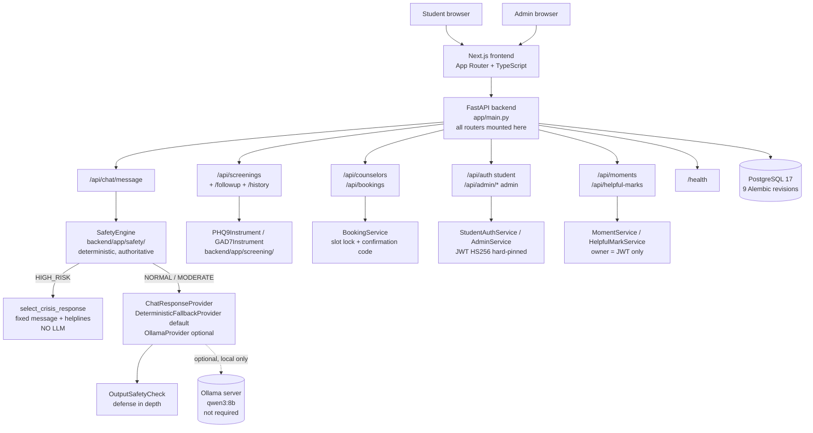
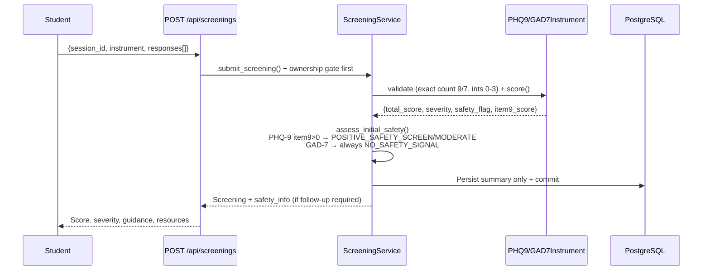
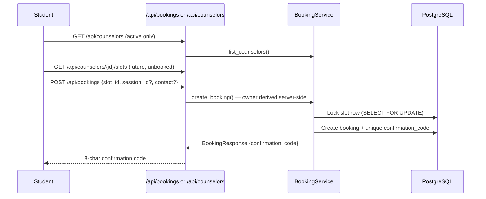

# Architecture — Mental Health Support for Students

This document describes the **implemented architecture** of the repository:
a privacy-first student support pathway built as a modular monolith with a
FastAPI backend, a Next.js frontend, and PostgreSQL.

It covers the original Milestones 1–12 scope (foundation, anonymous sessions,
deterministic safety engine, chat pipeline, PHQ-9/GAD-7 screening, resources,
booking, admin authentication, frontend pages, Ollama integration,
multilingual support, aggregate analytics) **plus** the student-identity work
that followed (optional student accounts, identity-bound sessions, owned
screening history, private Moments, helpful marks). Every behavior below was
verified against the source code; anything not implemented is called out under
[§15 Known limitations and future improvements](#15-known-limitations-and-future-improvements).

> **Scope note:** this system is a **support tool, not a replacement for
> professional care**. Safety behavior is deterministic and fail-closed, but
> crisis detection is keyword-based and cannot be guaranteed. See
> [§12](#12-privacy-and-security-considerations) and [§15](#15-known-limitations-and-future-improvements).

Related documents: `docs/safety-engine.md` (risk levels, engine design, crisis
flow), `docs/AI.md` (provider abstraction), `docs/API.md` (endpoint
reference), `docs/SECURITY-AND-PRIVACY.md` (controls), `README.md` (setup).

---

## 1. Purpose and scope

- **Purpose:** give contributors and reviewers a technically accurate map of
  how requests flow through the system, where safety decisions are made, what
  is persisted, and where trust boundaries lie.
- **In scope:** backend layers and routers, the safety engine and crisis
  pathway, the AI provider abstraction, screening/booking/analytics/moments
  workflows, authentication and authorization boundaries, configuration and
  deployment topology, testing.
- **Out of scope:** step-by-step setup (see `README.md` and
  `docs/GETTING_STARTED.md`), exhaustive endpoint schemas (see `docs/API.md`
  and `/docs` Swagger UI while the backend runs).

---

## 2. System overview

A student (anonymous or optionally signed in) uses the Next.js frontend, which
calls the FastAPI backend over HTTP. All safety classification is performed by
a deterministic, offline `SafetyEngine` **before** any generative model is
involved. High-risk messages never reach the LLM: they receive a fixed crisis
response from `backend/app/safety/crisis.py`. Normal/moderate messages are
answered by a provider behind the `ChatResponseProvider` abstraction
(deterministic fallback by default, local Ollama LLM when configured), then
re-checked by `OutputSafetyCheck` before delivery. Only safety **metadata** is
persisted — raw chat text and raw screening answers are never stored.



External/optional systems: the Ollama server is the only external runtime
dependency, and only when `AI_PROVIDER=ollama`. With the default
`AI_PROVIDER=fallback` the application runs fully without it. Deployment uses
Docker for **PostgreSQL only** (`docker/docker-compose.yml`); there is no
Redis, queue, or hosted-model dependency.

---

## 3. Technology stack and major components

| Layer | Technology | Pinned / configured version |
|---|---|---|
| Frontend framework | Next.js (App Router, `src/` layout) | 16.3.1 |
| Frontend UI / language | React 19.2.8, TypeScript `^5`, Tailwind CSS `^4` | `frontend/package.json` |
| Frontend tests | Vitest + Testing Library | 21 test files under `frontend/src` |
| Backend framework | FastAPI | `>=0.115, <1.0` |
| ASGI server | Uvicorn | `>=0.30, <1.0` |
| Database | PostgreSQL | 17 (docker image) |
| ORM / migrations | SQLAlchemy `>=2.0, <3.0` / Alembic `>=1.13, <2.0` | 9 revisions in `backend/migrations/versions/` |
| Settings | pydantic-settings `>=2.2, <3.0` | `backend/app/core/config.py` |
| Auth | python-jose (JWT, HS256 hard-pinned) + bcrypt | `>=3.5` / `>=4.0` |
| AI / LLM (optional) | Local Ollama server, model `qwen3:8b` | only when `AI_PROVIDER=ollama` |
| Backend testing | pytest + httpx | `>=8.0` / `>=0.27` |
| Drivers / misc | psycopg3 (`DATABASE_URL` uses `postgresql+psycopg://`) | `backend/requirements.txt` |

---

## 4. Component responsibilities and boundaries

| Layer | Directory | Responsibility — and what it must NOT do |
|---|---|---|
| **API routes** | `backend/app/api/routes/` | HTTP only: request/response validation (Pydantic), auth dependencies, rate-limit checks. Routers mounted in `backend/app/main.py`: `health`, `sessions`, `chat`, `screenings`, `auth` (student), `admin_auth`, `admin`, `counselors`, `bookings`, `admin_bookings`, `analytics`, `moments`, `helpful_marks`. No business logic. |
| **Services** | `backend/app/services/` | Business logic and transaction boundaries: `ChatService` (`chat.py`), providers (`chat_providers.py`), `OutputSafetyCheck` (`output_safety.py`), `ScreeningService` + `ScreeningSafetyService`, `BookingService`, `AnalyticsService`, `AdminService`, `StudentAuthService`, `SessionService`, `MomentService`, `HelpfulMarkService`, `UserHistoryService`, prompt building (`prompts.py`), ownership gates (`session_ownership.py`). Services commit/roll back; repositories never commit. |
| **Repositories** | `backend/app/repositories/` | Data access only (queries, staging adds). No business logic, no commits. |
| **Models** | `backend/app/models/` | SQLAlchemy ORM tables: `Session`, `SafetyEvaluation`, `Screening`, `User`, `RefreshToken`, `Admin`, `Counselor`, `CounselorSlot`, `Booking`, `Moment`, `HelpfulMark`. Imported via `models/__init__.py` so Alembic sees all metadata. |
| **Schemas** | `backend/app/schemas/` | Pydantic request/response DTOs (validation boundaries, e.g. `ChatMessageRequest` uses `extra="forbid"` so a smuggled `user_id` is rejected with 422). |
| **Safety** | `backend/app/safety/` | `SafetyEngine` (`engine.py`), `RiskAssessment`/`RiskLevel`/`RiskCategory` (`models.py`), Unicode normalization (`normalizers.py`), `KeywordClassifier` behind the `RiskClassifier` protocol (`classifiers/`), fixed crisis content (`crisis.py`). Fully LLM-independent. |
| **Screening** | `backend/app/screening/` | `PHQ9Instrument` / `GAD7Instrument` (`instruments.py`): validation, scoring, severity bands, Item-9 safety workflow. |
| **Security** | `backend/app/security/` | Central bcrypt password hashing (`passwords.py`, rejects >72-byte passwords instead of truncating) and student-token encode/decode (`tokens.py`). |
| **Core** | `backend/app/core/` | `config.py` (`Settings`, `ADMIN_AUTH_ALGORITHM`/`STUDENT_AUTH_ALGORITHM` hard-pinned to `"HS256"`), `db.py` (engine/session), `languages.py` (`en`/`hi`/`as` only). |
| **Frontend** | `frontend/src/` | Student pages (`app/(student)/`: chat, screening, check-ins, booking, resources, story, support-now, about, login, register), admin portal (`app/admin/`), reusable UI/shell (`components/`), API clients and auth helpers (`lib/`: `api.ts`, `session.ts`, `auth-api.ts`, `moments.ts`, `checkins.ts`, `helpful_marks.ts`, `wellbeing.ts`, admin clients). |

---

## 5. Request lifecycle and AI interaction

Different endpoint families follow different paths — there is no single
universal lifecycle. The chat pipeline below is the only path that contacts an
AI provider. Screening, booking, moments, and analytics never invoke the LLM.

```mermaid
sequenceDiagram
    participant S as Student
    participant R as POST /api/chat/message
    participant C as ChatService.process_message_async
    participant E as SafetyEngine.evaluate
    participant P as ChatResponseProvider
    participant O as OutputSafetyCheck.check
    participant D as PostgreSQL

    S->>R: {session_id, message, history?}
    R->>R: Pydantic validation (message 1-2000 chars,<br/>history max 8, extra fields rejected)
    R->>R: In-memory sliding-window rate limit<br/>(10 msgs/min per session_id, else 429)
    R->>C: process_message_async(session_id, message, history, current_user)
    C->>D: Load session row
    C->>C: Ownership gate (anonymous: public;<br/>owned: owner only, else 401/404)
    C->>C: Input validation (non-empty, max 2000 chars)<br/>+ history sanitized to last 8 valid turns
    C->>E: evaluate(message)
    E-->>C: RiskAssessment {level, category, matched_patterns}
    alt HIGH_RISK
        C->>C: select_crisis_response() — provider NEVER called
    else NORMAL / MODERATE
        C->>D: Latest screening summary (instrument/score/severity only)
        C->>P: generate_response(message, assessment, language, history, screening_context)
        P-->>C: ChatResponse {text, metadata}
        C->>C: Provider-output validation<br/>(empty or >2000 chars → ProviderError → safe fallback)
    end
    C->>O: check(response_text, risk_level)
    Note over O: HIGH_RISK short-circuits as trusted<br/>(fixed crisis module output);<br/>AI/fallback output is pattern-checked
    alt Output unsafe
        C->>C: Replace with get_safe_fallback(level, language)
    end
    C->>D: Persist SafetyEvaluation in transaction<br/>(SELECT session FOR UPDATE → next message_index → commit)
    C-->>R: ChatResult (response + risk/category/provider/model)
    R-->>S: ChatMessageResponse
```

Ordering guarantees verified in `backend/app/services/chat.py`:

1. **Route gate first, then session validation.** The route applies the
   per-session rate limit (429 on excess) before invoking the service; inside
   the service, session validation and the ownership gate run before any
   safety work (fast 404/401). Ownership never influences classification.
2. **Safety pre-check precedes generation.** `HIGH_RISK` takes the crisis
   branch and the provider object is never invoked.
3. **Provider output validation precedes the output safety check.** Empty,
   whitespace-only, or over-length (`>2000` chars, `MAX_RESPONSE_LENGTH`)
   provider text raises `ProviderError` and flows into the existing safe
   fallback.
4. **The output check runs on every path** (including crisis text, which
   short-circuits as trusted), and failures **reject** the whole response —
   the service substitutes `get_safe_fallback()`, never sanitizes.
5. **Persistence is last.** The `SafetyEvaluation` row is written after the
   final response text is decided, inside a transaction that locks the session
   row (`SELECT … FOR UPDATE`) to serialize concurrent messages per session
   and assign a gapless `message_index`. Unexpected route errors return a
   generic 500 without leaking internals.

`sync process_message()` still exists as a thin bridge for tests/non-async
callers and refuses to run inside a live event loop; the FastAPI route always
uses `process_message_async()`.

---

## 6. Safety engine and risk-routing behavior

Location: `backend/app/safety/`. The engine is deterministic, offline, and
**authoritative** — risk is never decided by the LLM.

Pipeline (`engine.py`):

1. **Length gate** — input over `MAX_INPUT_LENGTH = 2000` raises `ValueError`
   (fail-fast at the engine boundary; the route and service enforce the same
   limit first).
2. **Normalization** (`normalizers.py`) — Unicode-aware; preserves
   Hindi/Devanagari and Assamese/Bengali scripts instead of stripping them.
   Empty-after-normalization input returns `NORMAL/GENERAL`.
3. **Classification** — each configured `RiskClassifier` (default:
   `KeywordClassifier`, regex-based) returns `ClassificationMatch`es. The
   keyword classifier applies refined negation handling (genuine negations
   suppress matches; fixed expressions and uncertainty phrasing listed in
   `_NEGATION_EXCLUSION_PATTERNS` do not).
4. **Risk mapping** (`CATEGORY_RISK_LEVELS`) — `SUICIDE`, `SELF_HARM`,
   `PASSIVE_SI`, `ABUSE` → `HIGH_RISK`; `HOPELESSNESS`, `DEPRESSION`, `PANIC`
   → `MODERATE`; `ANXIETY`, `STRESS`, `BURNOUT`, `SLEEP`, `GENERAL` →
   `NORMAL`. Highest-severity match wins.
5. **Fail-closed** — classifier exceptions are recorded as failure markers;
   if no valid match survives (all classifiers failed), the engine returns
   `HIGH_RISK` rather than risking a safety bypass.

Risk routing (`chat.py`): `HIGH_RISK` → crisis branch (no provider call —
`DeterministicFallbackProvider` additionally refuses `HIGH_RISK` if ever
called with one); `NORMAL`/`MODERATE` → provider, with `MODERATE` fallback
responses carrying a gentle counseling/resources nudge.

Because classification is keyword-based, paraphrased or unlisted crisis
phrasing can be missed — this is a documented limitation, not a guarantee
(see §15).

---

## 7. Crisis handling and fallback behavior

- **Crisis content** (`safety/crisis.py`): `select_crisis_response()` returns a
  fixed warm, non-clinical message plus verified helplines per category
  (suicide/self-harm/passive-SI share the India national set — Tele-MANAS
  14416, KIRAN 1800-599-0019, AASRA, Vandrevala Foundation, Emergency 112;
  abuse uses Childline 1098 / Women's Helpline 181 / Tele-MANAS / 112).
  Content is currently **English-only** (multilingual crisis copy is future
  work — see the module comment). Calling it for non-`HIGH_RISK` raises
  `ValueError`.
- **Provider failure** (connection error, timeout, HTTP error, malformed
  Ollama payload, `</think>` reasoning-trace leakage, empty/over-length text)
  raises `ProviderError` inside `ChatService`, which substitutes
  `OutputSafetyCheck.get_safe_fallback(level, language)` — a guaranteed-safe
  deterministic response. Provider metadata records `safe_fallback` and the
  failure reason class (`provider_failure` / `output_safety_failed`).
- **Uncertain risk:** there is no "unknown" level — the engine always returns
  one of `NORMAL`/`MODERATE`/`HIGH_RISK`, failing closed to `HIGH_RISK`.

---

## 8. Output validation

`OutputSafetyCheck` (`backend/app/services/output_safety.py`) is a
deterministic regex layer — defense in depth over provider output:

- **Trusted pass:** `risk_level == "HIGH_RISK"` returns safe immediately,
  because that text originates from the fixed crisis module, not a model.
- **Phone-number control:** any phone-like pattern not in the authorized
  crisis-number set is rejected, so the AI can never hallucinate helplines —
  crisis numbers stay system-controlled.
- **Unsafe patterns rejected:** self-harm encouragement, crisis dismissal,
  prescription/medication advice, diagnosis claims ("you have …"), dismissal
  of professional help, and prompt-injection/roleplay markers (`ignore
  previous instructions`, `act as a doctor`, `bypass safety`, `system prompt`,
  …).
- **Failure mode:** reject-and-replace with `get_safe_fallback()` (level- and
  language-appropriate fixed text), never edit-in-place.

---

## 9. Data persistence and session management

**Privacy rule enforced across the codebase: raw chat text and raw screening
answers are never persisted.** Stored rows carry metadata/summaries only.

| Table | Key columns | Privacy property |
|---|---|---|
| `sessions` | `id` (UUID), `language`, `user_id` NULL = anonymous, timestamps | Metadata only; no content, no PII |
| `safety_evaluations` | `session_id`, `message_index` (unique per session), `risk_level` (CHECK `NORMAL`/`MODERATE`/`HIGH_RISK`), `category`, `matched_patterns` (JSONB), `classifier_sources` (JSONB), `language` | Assessment metadata only |
| `screenings` | `session_id`, `user_id` (nullable mirror of session owner), `instrument` (CHECK `PHQ9`/`GAD7`), `total_score`, `severity`, `safety_flag`, `item9_score`, timestamps | Summary metrics only; raw item arrays discarded after scoring |
| `users` | id, email (unique), password hash (bcrypt), display name, `deleted_at` (soft delete) | Student accounts (optional) |
| `refresh_tokens` | token hash, user FK, expiry, rotation/reuse tracking | Opaque refresh-token store |
| `counselors` / `counselor_slots` / `bookings` | staff profiles, availability windows, appointments (`slot_id`, nullable `session_id`/`user_id`, unique `confirmation_code`, contact fields optional, `status` CHECK) | Operational domain, separate from wellbeing |
| `moments` | `user_id` (NOT NULL, CASCADE), `body_plaintext` (CHECK 1–500 chars), `deleted_at`/`delete_expires_at` (5-second undo window) | Explicitly-saved user content; safety level evaluated pre-insert but **never persisted** |
| `helpful_marks` | `user_id`, `tool_id` (fixed registry id) | Preference marks only |
| `admins` | `username` (unique), bcrypt `password_hash`, `is_active` | Auth only |

**Sessions (`POST /api/sessions`, `GET /api/sessions/{id}`):**

- No auth → anonymous session (`user_id` NULL); valid student JWT → owned
  session (`user_id` = JWT subject, server-derived). A present-but-invalid
  Bearer credential returns 401 — requests never silently degrade to
  anonymous.
- Reads: anonymous sessions are public; owned sessions require the owner
  (no auth → 401, non-owner → 404 so existence is not revealed). All gates
  funnel through `require_session_access()` (`services/session_ownership.py`);
  there is no claim/transfer/merge path — old anonymous rows stay anonymous.

---

## 10. Screening, resources, and counselor workflows

### Screening (PHQ-9 / GAD-7)



Follow-up (`POST /api/screenings/followup {session_id, screening_id, action}`):
`ESCALATE_CRISIS` → `HIGH_RISK_AFTER_SAFETY_FOLLOWUP`/`HIGH_RISK` crisis
guidance; `SUPPORTIVE_CARE` → stays `POSITIVE_SAFETY_SCREEN`/`MODERATE`.
Only valid from an inferred `POSITIVE_SAFETY_SCREEN` state, for PHQ-9 rows
whose stored `item9_score > 0`, with session-ownership checked before lookup.

> **Implementation note:** the follow-up outcome is computed and returned, but
> the `screenings` table has **no `safety_state` column** — current state is
> re-derived from the stored `item9_score`/`safety_flag` on each call
> (`ScreeningSafetyService._infer_safety_state`). Repeated follow-ups
> therefore re-derive from the same stored summary.

Owned history (`GET /api/screenings/history`, `/history/latest`, via
`UserHistoryService`): authenticated-student only, filtered `WHERE user_id =
JWT.sub`, newest first, paginated (max 50/page). Anonymous rows and other
users' rows can never appear; no `user_id` parameter exists.

### Resources

There is **no backend resources API**. Verified helplines live on a static
frontend page (`app/(student)/resources/`), and
`backend/tests/test_resources_consistency.py` pins every number shown to
students to the authorized helpline set (the same numbers the crisis module
and output checker treat as system-controlled).

### Counselor booking (anonymous-first)



Ownership: anonymous bookings open via matching `session_id` **or** the
unguessable confirmation code (case-insensitive); account-owned bookings
require the authenticated owner — identifiers alone are insufficient
(`require_booking_access()`; unknown/unowned → identical 404). Status machine:
`PENDING → CONFIRMED / COMPLETED / CANCELLED`. Students can check status by
code (`GET /status/{code}`, minimal fields) and cancel with proof of
ownership. Admins (`/api/admin/*` bookings routes) get full CRUD but responses
never expose session ids, chat history, screening data, or safety evaluations.

### Private Moments (My Story) and helpful marks

Authenticated-only, ownership exclusively from the verified JWT:

- **Moments** (`/api/moments`): 1–500-char bodies (enforced in schema,
  service, and a DB CHECK), evaluated by the existing `SafetyEngine`
  pre-insert with the level returned transiently and never stored; the note
  saves at every level. Delete enters a 5-second recovery window
  (`deleted_at`/`delete_expires_at`; invisible to reads, restorable via
  `POST /{id}/restore`, then permanently swept). Creation throttled
  (30/hour/account); oversized bodies rejected pre-parse (413); validation
  errors never echo submitted text (custom 422 handler).
- **Helpful marks** (`/api/helpful-marks`): preference marks against a fixed
  server-side tool registry (unknown ids → 422); first mark → 201, re-mark →
  200; hard-delete is idempotent (204). No `SafetyEngine` contact — marking is
  a preference action, not a signal.

### Analytics (admin only)

`GET /api/admin/analytics?granularity=day|week|month&days=N` →
`AnalyticsService.get_dashboard()` → pre-aggregated `COUNT/GROUP BY/date_trunc`
queries → small-cell suppression (`MIN_CELL_SIZE = 5`: sensitive cells below
threshold return `count: null, suppressed: true`) → `AnalyticsResponse`.
Enforced rules: aggregate-only (no row-level data), wellbeing and booking
domains never joined in one query, provider identity never persisted (only
deterministic classifier sources). The separate `/api/admin/dashboard`
endpoint returns plain aggregate counts without suppression.

---

## 11. Authentication and authorization boundaries

| Surface | Mechanism | Enforcement point |
|---|---|---|
| Anonymous student use | UUID session, no credentials | `get_optional_student` returns `None`; anonymous rows stay public |
| Student accounts (optional) | `/api/auth/register`, `/login`, `/refresh`, `/logout`, `/me`. Short-lived access JWT (15 min, `type=student_access` + dedicated issuer) + rotating opaque refresh token (30 days, HttpOnly `SameSite=Lax` cookie scoped to `/api/auth`, CSRF-checked via Origin/Referer for cookie transport; JSON-body transport for native clients). Refresh reuse revokes the token family. Passwords bcrypt-hashed (min length 12, >72-byte rejected); duplicate email → 409 (documented trade-off, IP-throttled); login failures → generic 401 (unknown email, wrong password, and deleted accounts indistinguishable). Soft-deleted users rejected everywhere. | `app/api/deps.py`, `services/student_auth.py`, `security/tokens.py`, `api/rate_limit.py` (separate throttle instance from admin) |
| Session-scoped data (chat, screening, booking) | Dual regime: anonymous rows keep pre-existing public/code-based rules; owned rows require the JWT owner | `require_session_access()`, `require_booking_access()`; `ChatMessageRequest` forbids `user_id` (422) so ownership is always server-derived |
| Admin | `POST /api/admin/auth/login` → JWT (`type=access`, HS256 hard-pinned, 24 h default). Every `/api/admin/*` route requires it. Throttled per (username, IP) and per IP (5/20 failures per 15 min → 15-min lockout). Timing-equalized errors (bcrypt dummy work) prevent username enumeration. | `get_current_admin`, `services/admin.py` |
| Ownership oracles | 404 (not 403) for non-owners/unknown ids on sessions, bookings, moments; idempotent logout (204) and mark removal (204) reveal nothing | service/repository layer |

Student and admin tokens are separated by **both** signing secret and `type`
claim, so a token minted for one audience can never satisfy the other's
dependency (including `get_optional_student`, which rejects admin tokens with
401 rather than treating the request as anonymous).

---

## 12. Privacy and security considerations

- **Authoritative deterministic safety:** crisis classification never depends
  on the LLM; `HIGH_RISK` bypasses generation entirely; classifier failure
  fails closed.
- **Minimal persistence:** no chat text, no screening item arrays, no text
  hashes; moments store only explicitly-saved content; analytics are
  aggregates with small-cell suppression; booking and wellbeing domains are
  never joined.
- **System-controlled crisis info:** helplines originate from fixed modules;
  providers are blocked from emitting phone-like strings.
- **Secrets discipline:** `.env` files are gitignored; `.env.example` files
  carry placeholders only; production refuses placeholder `ADMIN_AUTH_SECRET`
  / `STUDENT_AUTH_SECRET` (and refuses equal secrets).
- **Honest limitations (no over-claims):** no end-to-end encryption;
  "anonymous" means no-account UUID sessions with metadata-only storage, not
  network-level anonymity (the server still observes transport metadata);
  chat/booking rate limits and login throttles are **in-memory and
  single-process** (multi-worker deployments need Redis or proxy-level
  limiting); admin JWTs have no revocation list; crisis detection is
  keyword-based and probabilistic in practice despite deterministic code.

---

## 13. Configuration and deployment topology

All runtime configuration is environment variables (see root `.env.example`
and `backend/.env.example`; frontend uses `NEXT_PUBLIC_API_URL`, default
`http://localhost:8000`):

| Variable | Purpose | Default |
|---|---|---|
| `DATABASE_URL` | PostgreSQL (`postgresql+psycopg://…`) | required for data-backed features |
| `ENVIRONMENT` | `development` / `test` / `production` | `development` |
| `CORS_ORIGINS` | Allowed browser origins | `["http://localhost:3000"]` |
| `AI_PROVIDER` | `fallback` (deterministic) / `ollama` | `fallback` |
| `OLLAMA_BASE_URL` / `OLLAMA_MODEL` | Local LLM endpoint / model | `http://localhost:11434` / `qwen3:8b` |
| `OLLAMA_TIMEOUT_SECONDS` | LLM request timeout (code default `3.5`; repo's `backend/.env.example` uses `120` for slow local CPU inference) | `3.5` |
| `OLLAMA_ENABLE_THINKING` | Send `think: true` so reasoning traces stay out of answers | `true` |
| `ADMIN_AUTH_SECRET` / `ADMIN_AUTH_TOKEN_EXPIRE_MINUTES` | Admin JWT secret / lifetime | placeholder (refused in prod) / `1440` |
| `ADMIN_LOGIN_*` | Admin throttle thresholds/windows | `5` / `20` / `900` / `900` |
| `STUDENT_AUTH_SECRET` / `STUDENT_ACCESS_TOKEN_EXPIRE_MINUTES` / `STUDENT_REFRESH_TOKEN_EXPIRE_DAYS` / `STUDENT_REFRESH_COOKIE_NAME` / `STUDENT_PASSWORD_MIN_LENGTH` | Student JWT secret / lifetimes / cookie / policy | placeholder / `15` / `30` / `mh_refresh` / `12` |
| `STUDENT_LOGIN_*` | Student throttle (separate instance) | `5` / `20` / `900` / `900` |

`ADMIN_AUTH_ALGORITHM` is **not** configurable (hard-pinned `HS256` in
`core/config.py`). Topology: Next.js client → Uvicorn/FastAPI → PostgreSQL 17
(Docker Compose service `db`, volume `pgdata`); Ollama optional and external.
`/health` reports `database: connected|unavailable|not_configured`. Suggested
production posture (not yet implemented): strong secrets, `ENVIRONMENT=production`,
managed Postgres with pooling, TLS-terminating reverse proxy, shared throttle
store, log redaction review.

---

## 14. Testing and verification

- **Backend:** 491 test functions across 18 files in `backend/tests/`
  (statically counted `def test_*` definitions; the suite uses no
  `@pytest.mark.parametrize`, so collected items equal this count). Coverage
  includes safety-engine unit tests, chat-pipeline and AI-routing tests,
  screening and Item-9 follow-up tests, booking/ownership tests, admin/auth
  tests, analytics suppression tests, moments/helpful-mark tests,
  identity/history-isolation tests (Phases 1A/2B/3B/3E), and a
  resources-consistency test. `conftest.py` provisions a dedicated
  `mental_health_test` database, applies all Alembic migrations, and truncates
  tables between tests — so **executing the suite requires a live PostgreSQL**;
  counts above are by static inspection, and no full-suite run is claimed here.
- **Frontend:** 21 Vitest test files (`__tests__` under `frontend/src`,
  ~188 `it`/`test` cases) plus `npm run lint` (ESLint 9) and `npm run build`
  (production build with type-checking).

---

## 15. Known limitations and future improvements

Implemented behavior ends here; the following are explicitly **not** done:

- Keyword-based safety can miss paraphrased, coded, or unsupported-language
  crisis expression; no clinical validation; not a substitute for
  professional care — escalate to human help (112 / Tele-MANAS 14416).
- Crisis copy is English-only; session languages `hi`/`as` are accepted and
  preserved through normalization, but localized crisis/support strings are
  future work.
- Screening follow-up outcomes are not persisted as state (re-derived per
  call); no longitudinal clinical record is kept by design.
- No admin bootstrap CLI (manual creation via `AdminService`); no admin token
  revocation; student account recovery/deletion flows are minimal
  (soft-delete flag only).
- Rate limiting and login throttles are in-memory/single-process; no Redis,
  no automated dependency scanning in CI, no penetration test / formal
  security review, no production hardening (TLS, CSP, HSTS) in-repo.
- Helpline set is India-focused; international users get generic guidance
  (`findahelpline.com` in screening resources).
